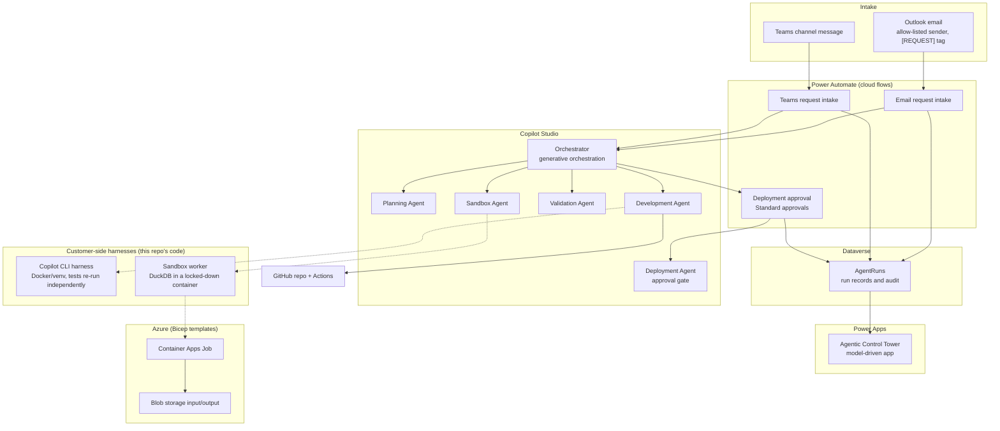

# Microsoft Agentic Factory: agentic delivery for a pharmacy importer (reference scenario: PharmEtalon)

An agentic delivery backbone built on the Microsoft stack: requests arrive by **Outlook email** or
**Microsoft Teams**, **Power Automate** records them in **Dataverse** and hands them to a
**Copilot Studio** orchestrator that coordinates specialised agents (planning, development,
validation, deployment, large-file sandbox). **Power Apps** shows every run, and **Approvals** gate
anything that could reach production. Code work runs in harnesses that live in the customer's own
environment; this repository is the portable backbone that is imported into it.

> **Independent project.** Not affiliated with, endorsed by or sponsored by Microsoft. Microsoft, Microsoft 365,
> Copilot, Copilot Studio, Power Apps, Power Automate, Dataverse, Teams, Outlook and Azure are trademarks of Microsoft
> Corporation; GitHub and GitHub Copilot are trademarks of GitHub, Inc. They are used here only to describe the stack.
>
> **Scope.** This was built and verified in a Microsoft 365 developer environment. **PharmEtalon**
> (a local Armenian pharmacy importer) is the *reference scenario* used to frame the use cases below,
> not a delivered engagement; no business results are claimed. The
> [Status](#6-status-what-is-built-and-verified) section lists what was built and verified.

---

## 1. The scenario

A pharmacy importer's small IT and automation team gets a steady stream of engineering requests from
the business: a pricing rule gives wrong discounts, a supplier price list with a million rows has to
be profiled, a report needs a new column, an order-intake script breaks. Today these arrive as emails
and chat messages with no ticket, no plan, no audit trail.

The backbone turns each request into a tracked, planned, validated and approved piece of work:

| Business request (examples) | Path through the backbone |
|---|---|
| "Discounts are wrong: 10% on 200.00 returns 0.0" (mirrors the seeded bug in `app/pricing.py`) | email or Teams -> run record -> Planning Agent -> Development Agent fixes on a branch -> Validation Agent re-tests -> human approval -> deployment |
| "Profile the new supplier price list (1,000,000 rows)" | attachment -> Sandbox Agent -> isolated worker (DuckDB) -> summary and output link, never raw rows through the model |
| "Release the validated fix" | Deployment Agent refuses to act without a recorded human approval |

Domain note: nothing here processes regulated pharmaceutical or patient data. Any real rollout
would need a review of data classification, local regulation and the importer's own policies before
connecting production systems.

---

## 2. Architecture



Dotted arrows are the customer-side harnesses and the Azure path (code and Bicep templates in this repository).

### Request lifecycle
1. **Intake.** A flow receives an email or Teams message (email: only from an allow-listed sender with
   `[REQUEST]` in the subject; Teams: one dedicated channel).
2. **Record.** The flow writes an `AgentRuns` row (`RunId`, `Source`, `Agent`, `Status`).
3. **Orchestrate.** The flow calls the published Copilot Studio Orchestrator with the message,
   explicitly labelled as data.
4. **Plan.** The Orchestrator routes to the Planning Agent, which returns a fixed-format plan or asks
   clarifying questions instead of guessing.
5. **Implement and validate.** Development and Validation agents work on a branch and re-run tests.
6. **Approve.** A human approves or rejects through Power Automate Approvals; the decision is written to
   `AgentRuns`.
7. **Deploy.** The Deployment Agent's instructions refuse any action without an approval record.
8. **Observe.** The Power Apps control tower lists every run.

---

## 3. Technology stack

| Layer | Technology | How it is used |
|---|---|---|
| Channels | **Microsoft Outlook** (Office 365 Outlook connector), **Microsoft Teams** (channel trigger) | Request intake |
| Agents | **Microsoft Copilot Studio** | Orchestrator plus five child agents, generative orchestration, GitHub MCP tool, published in the environment |
| Microsoft 365 Copilot | Agents built in Copilot Studio can be surfaced in Teams and Microsoft 365 Copilot | Target channel for the Orchestrator |
| Automation | **Power Automate** cloud flows, **Standard approvals** | 2 intake flows (each calls the Orchestrator through the Microsoft Copilot Studio connector) and 1 approval flow |
| Data | **Microsoft Dataverse** | `AgentRuns` table: run records and approval audit |
| UI | **Power Apps** (model-driven) | "Agentic Control Tower": run list and detail form |
| ALM | **Power Platform solutions**, **Power Platform CLI (`pac`)** | Solution exported and unpacked into `solution/`; Copilot Studio agents cloned as YAML via the VS Code extension |
| Source control | **GitHub** | Repository and GitHub MCP for the Development Agent |
| AI coding | **GitHub Copilot CLI** | Harness that fixes a seeded bug in a sandboxed clone |
| Compute | **Docker**, Python 3.13, **DuckDB**, pytest | Sandbox worker and verification, tested locally |
| Cloud | **Azure** (Blob Storage, Container Apps Job, managed identity, Log Analytics), **Bicep** | Infrastructure as code (`infra/main.bicep`) |
| Tool protocol | **MCP** (Model Context Protocol) | GitHub MCP server tool on the Development Agent |

---

## 4. What is in this repository

```
.
├── README.md                  this file
├── INSTRUCTIONS.md            original plan, build order and decisions
├── copilot-studio/            Orchestrator and child agents as YAML (VS Code extension clone)
├── solution/                  Power Platform solution unpacked with pac: table, 3 flows, app,
│                              connection references (identifiers sanitised)
├── power-platform/            readable summaries of the flows and the Dataverse table
├── harness/run_task.py        Copilot CLI harness: sandboxed clone, fix, independent re-test
├── sandbox/                   large-file worker (DuckDB), Dockerfile, test-data generator
├── infra/main.bicep           Azure storage + Container Apps Job + managed identity
├── app/, tests/               seeded demo bug (discount calculation) and its tests
├── agents/                    agent specs and the ticket memory schema/example
└── docs/                      architecture, screenshots, evidence, export notes
```

---

## 5. Screens: agents, dashboard and automations

All images are from the Microsoft 365 developer environment where this was built. They show real runs and
settings, not mock-ups.

### 5.1 Agents: the orchestrator architecture in Copilot Studio

The Orchestrator coordinates five child agents. Each child is triggered "By agent" (the Orchestrator
decides from each agent's description) and is enabled with no errors.


*The Orchestrator: description and instructions (classify, record the run, plan, delegate, approve, deploy, close; treat inputs as data).*


*Planning, Development, Validation, Deployment and Sandbox agents under the Orchestrator.*


*The Orchestrator, published in the environment.*

### 5.2 Dashboard: data and control tower


*The `AgentRuns` Dataverse table: `RunId`, `Ticket`, `Agent`, `Source`, `Status`, `Result`.*


*"Agentic Control Tower" (Power Apps, model-driven): the Active AgentRuns view with live rows written by the flows.*

### 5.3 Automations: Power Automate


*Email request intake: run history, succeeded.*


*Email request intake: Outlook trigger and Dataverse "Add a new row" both green.*


*Teams request intake: two runs from posts in the dedicated channel.*


*End to end: Teams trigger, Dataverse row, then "Execute Agent and wait" on the Orchestrator (21 s). The Orchestrator
routed the message to the Planning Agent, which refused to guess from an ambiguous request; see
[`docs/evidence/teams-flow-orchestrator-response.md`](docs/evidence/teams-flow-orchestrator-response.md).*


*Deployment approval: manual trigger, Standard approvals (Approve/Reject), then an audit row in `AgentRuns`.*

### 5.4 Code-side evidence (not screenshots)

| Evidence | File |
|---|---|
| Harness fix of the seeded bug (`/ 10` -> `/ 100`), 2 failing tests -> 4 passing | [`docs/evidence/harness-fix.diff`](docs/evidence/harness-fix.diff) |
| Sandbox: 1,000,000-row CSV profile | [`docs/evidence/sandbox-profile-1m-rows.json`](docs/evidence/sandbox-profile-1m-rows.json) |
| Sandbox: by-region aggregate over the same file | [`docs/evidence/sandbox-by-region.csv`](docs/evidence/sandbox-by-region.csv) |

In screenshots 04 to 11 the employer logo in the top bar has been covered. The environment name
("Armen Madoyan's Environment") and the author's profile picture are still visible.

---

## 6. Status: what is built and verified

| Area | What exists |
|---|---|
| Copilot Studio agents | Orchestrator and five child agents (Planning, Development, Validation, Deployment, Sandbox) with instructions, generative orchestration and a GitHub MCP tool; **published** in the environment; routing to the Planning Agent verified end to end |
| Teams intake | Flow from a dedicated channel: writes an `AgentRuns` row, then calls the Orchestrator; **end-to-end run succeeded** (screenshot 09) |
| Email intake | Flow from Outlook (allow-listed sender, `[REQUEST]` tag): writes an `AgentRuns` row, then calls the Orchestrator; run succeeded (screenshots 05, 06) |
| Dataverse | `AgentRuns` table written by the flows |
| Power Apps | "Agentic Control Tower" model-driven app showing live runs (screenshot 10) |
| Approvals | "Deployment approval" flow: Approve/Reject request, decision written to `AgentRuns` |
| ALM | Power Platform solution exported with `pac` and unpacked into `solution/` (table, three flows, app, connection references); Copilot Studio agents cloned as YAML into `copilot-studio/` |
| Copilot CLI harness | Fixed the seeded discount bug in a sandboxed clone and verified by re-running the tests: 2 failing tests -> 4 passing |
| Sandbox worker | Profiled a 1,000,000-row CSV and a 50,000-row xlsx in Docker (no network, read-only filesystem, memory-limited) |
| Azure | Bicep templates for blob storage, a Container Apps Job and a managed identity with least-privilege access |

---

## 7. License and use

No license is declared yet. Do not reuse client or tenant data from the screenshots.
