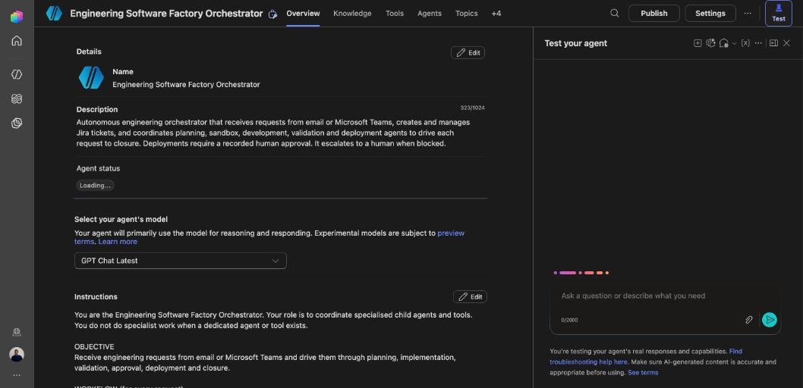
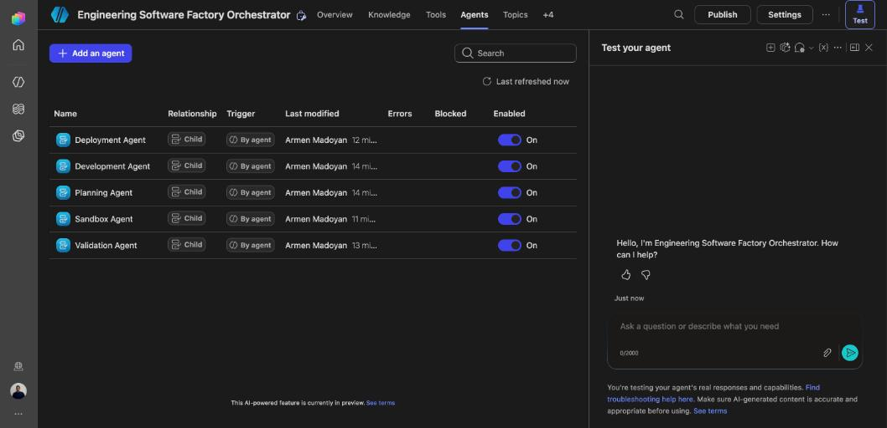
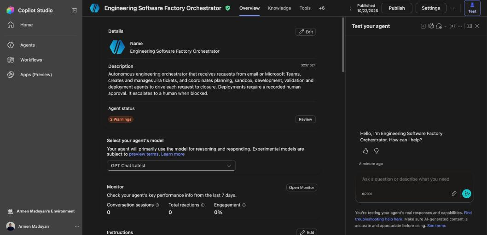
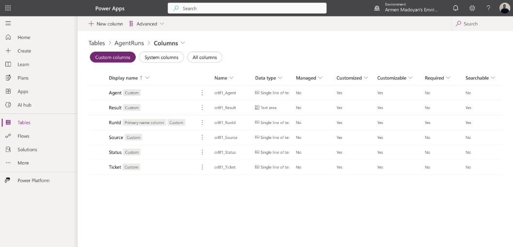
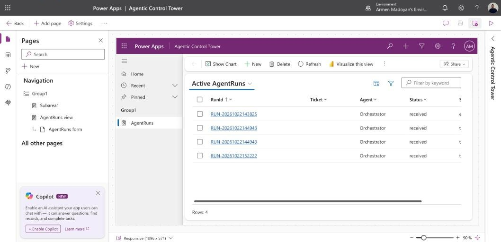
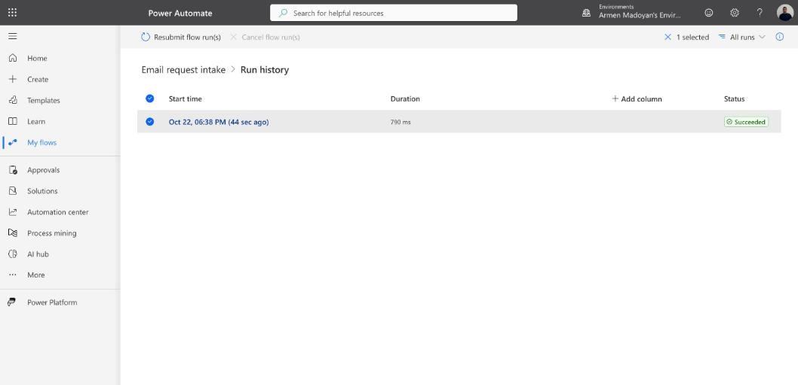
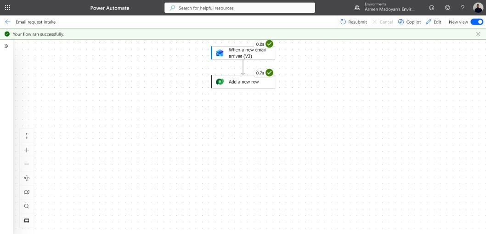
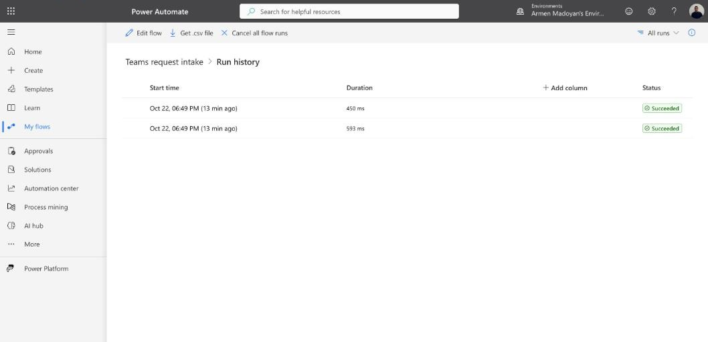
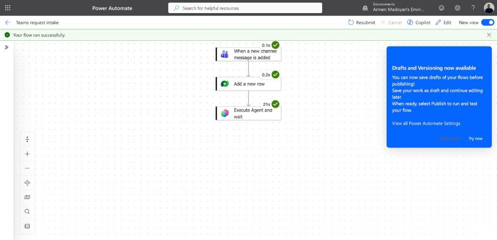
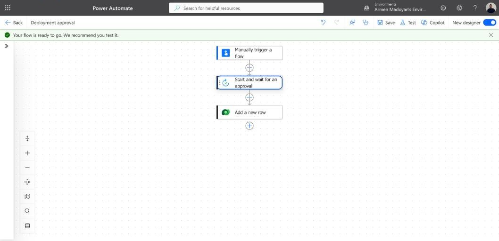

# Agentic SDLC for a Pharmacy Importer (reference scenario: PharmEtalon)

An agentic delivery backbone built on the Microsoft stack: requests arrive by **Outlook email** or
**Microsoft Teams**, **Power Automate** records them in **Dataverse** and hands them to a
**Copilot Studio** orchestrator that coordinates specialised agents (planning, development,
validation, deployment, large-file sandbox). **Power Apps** shows every run, and **Approvals** gate
anything that could reach production. Code work runs in harnesses that live in the customer's own
environment; this repository is the portable backbone that is imported into it.

> **Scope and honesty.** This was built and tested in a Microsoft 365 developer environment.
> **PharmEtalon** (a local Armenian pharmacy importer) is the *reference scenario* used to frame the
> use cases below. It is **not** a delivered engagement, nothing here was deployed at the company, and
> no business results are claimed. Section [Status](#status-what-is-built-tested-and-not-done) states
> exactly what was built, what was tested, and what was not.

---

## 1. The scenario

A pharmacy importer's small IT and automation team gets a steady stream of engineering requests from
the business: a pricing rule gives wrong discounts, a supplier price list with a million rows has to
be profiled, a report needs a new column, an order-intake script breaks. Today these arrive as emails
and chat messages with no ticket, no plan, no audit trail.

The backbone turns each request into a tracked, planned, validated and approved piece of work:

| Business request (examples) | Path through the backbone |
|---|---|
| "Discounts are wrong: 10% on 200.00 returns 0.0" (mirrors the seeded bug in `app/pricing.py`) | email or Teams -> run record -> Planning Agent -> Development Agent fixes on a branch -> Validation Agent re-tests -> human approval -> deployment |
| "Profile the new supplier price list (1,000,000 rows)" | attachment -> Sandbox Agent -> isolated worker (DuckDB) -> summary and output link, never raw rows through the model |
| "Release the validated fix" | Deployment Agent refuses to act without a recorded human approval |

Domain note: nothing here processes regulated pharmaceutical or patient data. Any real rollout
would need a review of data classification, local regulation and the importer's own policies before
connecting production systems.

---

## 2. Architecture


Solid arrows are built and exercised; dotted arrows are designed or run only locally.

### Request lifecycle
1. **Intake.** A flow receives an email or Teams message (email: only from an allow-listed sender with
   `[REQUEST]` in the subject; Teams: one dedicated channel).
2. **Record.** The flow writes an `AgentRuns` row (`RunId`, `Source`, `Agent`, `Status`).
3. **Orchestrate.** The flow calls the published Copilot Studio Orchestrator with the message,
   explicitly labelled as data.
4. **Plan.** The Orchestrator routes to the Planning Agent, which returns a fixed-format plan or asks
   clarifying questions instead of guessing.
5. **Implement and validate.** Development and Validation agents work on a branch and re-run tests.
6. **Approve.** A human approves or rejects through Power Automate Approvals; the decision is written to
   `AgentRuns`.
7. **Deploy.** The Deployment Agent's instructions refuse any action without an approval record.
8. **Observe.** The Power Apps control tower lists every run.

---

## 3. Technology stack

| Layer | Technology | How it is used |
|---|---|---|
| Channels | **Microsoft Outlook** (Office 365 Outlook connector), **Microsoft Teams** (channel trigger) | Request intake |
| Agents | **Microsoft Copilot Studio** | Orchestrator plus five child agents, generative orchestration, GitHub MCP tool, published in the environment |
| Microsoft 365 Copilot | Copilot Studio agents can be surfaced in Teams and Microsoft 365 Copilot | **Not configured** (see status) |
| Automation | **Power Automate** cloud flows, **Standard approvals** | 2 intake flows (each calls the Orchestrator through the Microsoft Copilot Studio connector) and 1 approval flow |
| Data | **Microsoft Dataverse** | `AgentRuns` table: run records and approval audit |
| UI | **Power Apps** (model-driven) | "Agentic Control Tower": run list and detail form |
| ALM | **Power Platform solutions**, **Power Platform CLI (`pac`)** | Solution exported and unpacked into `solution/`; Copilot Studio agents cloned as YAML via the VS Code extension |
| Source control | **GitHub** | Repository, GitHub MCP for the Development Agent, Actions planned for deployment |
| AI coding | **GitHub Copilot CLI** | Harness that fixes a seeded bug in a sandboxed clone |
| Compute | **Docker**, Python 3.13, **DuckDB**, pytest | Sandbox worker and verification, tested locally |
| Cloud | **Azure** (Blob Storage, Container Apps Job, managed identity, Log Analytics), **Bicep** | Infrastructure as code, **not deployed or tested** |
| Tool protocol | **MCP** (Model Context Protocol) | GitHub MCP server tool on the Development Agent |

---

## 4. What is in this repository

```
.
├── README.md                  this file
├── INSTRUCTIONS.md            original plan, build order and decisions
├── copilot-studio/            Orchestrator and child agents as YAML (VS Code extension clone)
├── solution/                  Power Platform solution unpacked with pac: table, 3 flows, app,
│                              connection references (identifiers sanitised)
├── power-platform/            readable summaries of the flows and the Dataverse table
├── harness/run_task.py        Copilot CLI harness: sandboxed clone, fix, independent re-test
├── sandbox/                   large-file worker (DuckDB), Dockerfile, test-data generator
├── infra/main.bicep           Azure storage + Container Apps Job + managed identity (untested)
├── app/, tests/               seeded demo bug (discount calculation) and its tests
├── agents/                    agent specs and the ticket memory schema/example
└── docs/                      architecture, screenshots, evidence, export notes
```

---

## 5. Screens: agents, dashboard and automations

All images are from the developer environment where this was built. They show real runs and
settings, not mock-ups.

### 5.1 Agents: the orchestrator architecture in Copilot Studio

The Orchestrator coordinates five child agents. Each child is triggered "By agent" (the Orchestrator
decides from each agent's description) and is enabled with no errors.


*The Orchestrator: description and instructions (classify, record the run, plan, delegate, approve, deploy, close; treat inputs as data).*


*Planning, Development, Validation, Deployment and Sandbox agents under the Orchestrator.*


*The Orchestrator published in the environment (two status warnings remain: no evaluation run yet, premium features).*

### 5.2 Dashboard: data and control tower


*The `AgentRuns` Dataverse table: `RunId`, `Ticket`, `Agent`, `Source`, `Status`, `Result`.*


*"Agentic Control Tower" (Power Apps, model-driven): the Active AgentRuns view with live rows written by the flows.*

### 5.3 Automations: Power Automate


*Email request intake: run history, succeeded.*


*Email request intake: Outlook trigger and Dataverse "Add a new row" both green.*


*Teams request intake: two runs from posts in the dedicated channel.*


*End to end: Teams trigger, Dataverse row, then "Execute Agent and wait" on the Orchestrator (21 s). The Orchestrator
routed the message to the Planning Agent, which refused to guess from an ambiguous request; see
[`docs/evidence/teams-flow-orchestrator-response.md`](docs/evidence/teams-flow-orchestrator-response.md).*


*Deployment approval: manual trigger, Standard approvals (Approve/Reject), then an audit row in `AgentRuns`. Built and saved; not yet run.*

### 5.4 Code-side evidence (not screenshots)

| Evidence | File |
|---|---|
| Harness fix of the seeded bug (`/ 10` -> `/ 100`), 2 failing tests -> 4 passing | [`docs/evidence/harness-fix.diff`](docs/evidence/harness-fix.diff) |
| Sandbox: 1,000,000-row CSV profile | [`docs/evidence/sandbox-profile-1m-rows.json`](docs/evidence/sandbox-profile-1m-rows.json) |
| Sandbox: by-region aggregate over the same file | [`docs/evidence/sandbox-by-region.csv`](docs/evidence/sandbox-by-region.csv) |

Screenshots 04 to 11 show a company logo and the environment name; review them before making this
repository public.

---

## 6. Status: what is built, tested and not done

| Area | Status |
|---|---|
| Copilot Studio Orchestrator + 5 child agents, instructions, generative orchestration | Built, **published in the developer environment**; no channel (Teams or Microsoft 365 Copilot) configured; status shows 2 warnings (no evaluation run, premium features) |
| Email intake flow -> `AgentRuns` -> Orchestrator | Built; first run succeeded before the Orchestrator step was added; **the combined path was not re-run for email** |
| Teams intake flow -> `AgentRuns` -> Orchestrator | Built; **one end-to-end run succeeded** (message answered by the Planning Agent) |
| Deployment approval flow (approve/reject + audit row) | Built and saved; **never run**; not called by the Deployment Agent |
| Dataverse `AgentRuns` | Built; publishing customizations was needed before flows could see it |
| Power Apps control tower | Built; shows live rows; the run-detail form was not exercised |
| `pac` solution export/unpack | Done; **importing into a clean environment not tested** |
| Copilot Studio YAML (VS Code extension) | Cloned and committed; **applying it back not tested** |
| Development Agent GitHub tool | Added; **connection verification in the test chat unfinished**, so code read/write through Copilot Studio is unproven |
| Copilot CLI harness | Tested locally on the seeded bug (fix verified by re-running tests) |
| Sandbox worker | Tested locally in Docker with no network, read-only filesystem: 1M-row CSV and a 50k-row xlsx |
| Azure Bicep (storage, Container Apps Job, managed identity) | Written, **not deployed or tested** (no subscription, no `az` CLI) |
| Jira (create, assign, comment, close) | **Not built** |
| Run-record updates by later stages, plan stored in `AgentRuns.Result`, Teams reply | **Not built** |
| HTTP API / custom connector in front of the harnesses | **Not built** |
| Publish to Teams / Microsoft 365 Copilot, evaluation run | **Not done** |
| Power BI analytics | **Not built** |

Known weaknesses: RunIds are timestamp-based and can collide in the same second; the default
"escalate to a representative" topic still appends a generic message after replies.

---

## 7. Security and governance design

- **Untrusted input.** Email and chat text is labelled as data in the flow message and in every agent's
  instructions. The email trigger only accepts one allow-listed sender plus a subject tag.
- **Human approval before deployment.** The Deployment Agent must receive an approval record
  (approver, decision, timestamp). The approval flow produces that record. Enforcement in code is not
  built yet.
- **Independent verification.** The harness and the Validation Agent re-run tests rather than trusting an
  agent's claim; the harness denies `git push` and destructive shell commands to Copilot.
- **Big data stays out of the model.** The sandbox worker returns summaries and links only.
- **Least privilege on Azure (designed).** Managed identity with Storage Blob Data Contributor, shared-key
  and public blob access disabled.
- **No secrets in the repo.** Connections and tokens are never committed; identifiers in the exported
  solution (sender, approver, Teams ids) are replaced with placeholders.

---

## 8. Reproducing it

Prerequisites: a Microsoft 365 / Power Platform environment with Dataverse and Copilot Studio, a GitHub
account, VS Code with the Copilot Studio and Power Platform extensions, Docker, Python 3.13, and
(optionally) GitHub Copilot CLI.

1. **Power Platform solution.** Zip `solution/` with `pac solution pack`, import it, create the
   Dataverse, Outlook, Teams and Approvals connections, then set the placeholders (sender allow-list,
   approver, Teams team and channel). Publish all customizations. *Round trip not tested.*
2. **Copilot Studio agents.** Clone a blank agent with the VS Code extension, copy the YAML from
   `copilot-studio/`, apply, then publish. Recreate the GitHub connection. *Round trip not tested.*
3. **Local harness.**
   ```
   python -m venv .venv && .venv/bin/pip install -r requirements.txt
   .venv/bin/python harness/run_task.py agents/memory/DEMO-1.example.json
   ```
   Runs Copilot CLI in a sandboxed clone and re-runs the tests itself (needs `copilot` installed and
   signed in; copy the example to `agents/memory/DEMO-1.json`).
4. **Sandbox worker (local).**
   ```
   docker build -f sandbox/Dockerfile -t sandbox-worker .
   docker run --rm --network none --memory 2g --read-only --tmpfs /tmp \
     -v "$PWD/data:/data:ro" -v "$PWD/out:/out" \
     sandbox-worker --input /data/file.csv --output /out/run1 --task profile
   ```
5. **Azure (untested).** `az deployment group create -g <rg> -f infra/main.bicep -p image=<registry>/sandbox-worker:latest`;
   a private registry needs registry settings and an AcrPull role first.
6. **Exporting changes.** `pac solution export` then `unpack` (commands in `docs/solution-export.md`),
   and sanitise identifiers before committing.

---

## 9. Roadmap

1. Close the loop: write the plan into `AgentRuns.Result` and reply in the Teams channel.
2. Verify the Development Agent's GitHub connection and run a plan-only, then a branch-only, test.
3. Add Jira (ticket create/assign/comment/close) behind a flow-backed action.
4. Make the approval an enforced gate: Deployment Agent calls the approval flow and refuses on reject.
5. Configure the Teams and Microsoft 365 Copilot channels and run an evaluation set.
6. Put an HTTP API and custom connector in front of the harness and sandbox; deploy the Azure pieces.
7. Add Power BI on `AgentRuns` (success rate, time to resolution).
8. Add unique run ids and an import test of the solution into a clean environment.

---

## 10. License and use

No license is declared yet. Do not reuse client or tenant data from the screenshots.
