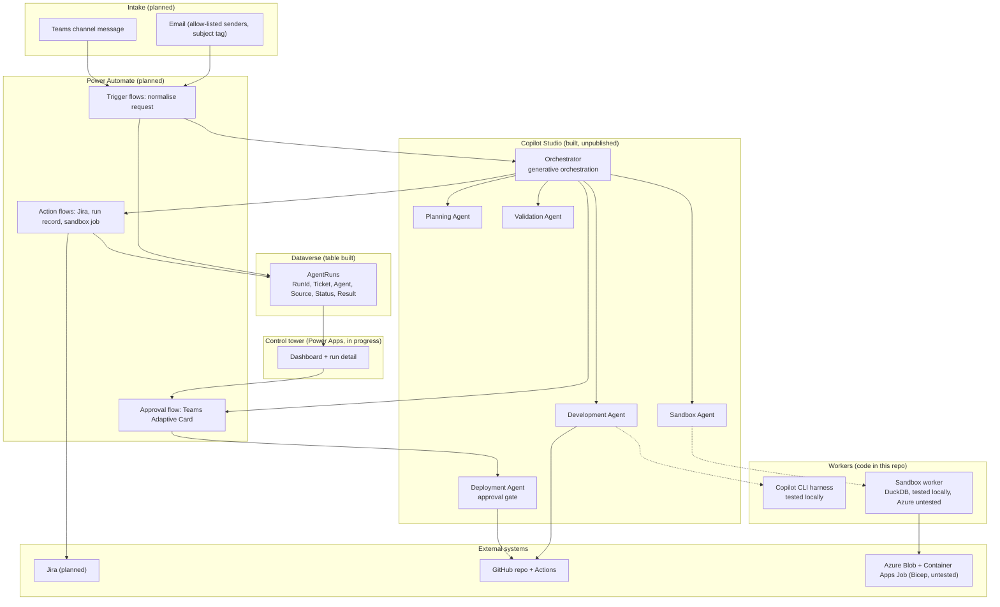

# Architecture

An agentic delivery pipeline: a request arrives by email or Teams, an orchestrator in Copilot Studio
coordinates specialised child agents, state lives in Dataverse, Power Automate does the actions and
approvals, and code work runs in an isolated worker.

## Status legend
- **Built**: exists and was checked (see screenshots and evidence).
- **Built, untested**: written but not run against real services.
- **Planned**: designed only.

## System diagram

## Request lifecycle
1. **Intake**: a flow receives an email or Teams message and normalises it (title, description, priority, source, requester, attachment links). Email bodies are data, never instructions.
2. **Record**: a row is written to `AgentRuns`.
3. **Plan**: the Orchestrator calls the Planning Agent for a design and execution plan.
4. **Large files**: the Sandbox Agent hands attachments to the sandbox worker and returns summaries and links, never rows.
5. **Implement**: the Development Agent works on a branch, reproduces, fixes, and reports real test output.
6. **Validate**: the Validation Agent rebuilds and retests independently and checks tests were not weakened.
7. **Approve**: a human approves through a Teams Adaptive Card or the control tower. The approval record is stored.
8. **Deploy**: the Deployment Agent refuses to act without an approval record (approver, decision, timestamp).
9. **Close**: the run record is updated, Jira is commented and closed, and the requester is notified.

## Components and status

| Component | Where | Status |
|---|---|---|
| Orchestrator, description, instructions, generative orchestration | Copilot Studio | Built and published in the developer environment (screenshot 08); status still shows two warnings (no evaluation run, premium features) |
| Planning, Development, Validation, Deployment, Sandbox agents | Copilot Studio | Built; Planning routing checked, Development routing checked but GitHub step waits on connection verification |
| GitHub MCP tool on Development Agent | Copilot Studio | Added; connection awaiting verification |
| `AgentRuns` table | Dataverse | Built (6 columns) |
| Model-driven app "Agentic Control Tower" (AgentRuns view and form) | Power Apps | Built and saved; shows live rows (screenshot 10); not yet added to the exported solution |
| Copilot CLI harness (`harness/run_task.py`) | This repo | Built, tested locally on the seeded bug |
| Sandbox worker (`sandbox/worker.py`) | This repo | Built, tested locally on 1M-row CSV and xlsx |
| Azure infrastructure (`infra/main.bicep`) | This repo | Built, untested |
| Email intake flow (Outlook trigger -> `AgentRuns` row) | Power Automate | Built, one successful test run before the Orchestrator step was added (screenshots 05, 06); now also calls the Orchestrator with the email subject and body preview (saved, not yet run) |
| Teams intake flow (channel message -> `AgentRuns` row) | Power Automate | Built, two successful runs (screenshot 07); trigger polls, so runs appear a few minutes after a post; now also calls the Orchestrator with the channel message; one successful end-to-end run (screenshot 09, docs/evidence/teams-flow-orchestrator-response.md) |
| Deployment approval flow (Approve/Reject, decision written to `AgentRuns`) | Power Automate | Built and saved, not yet run (`power-platform/flows/deployment-approval.md`) |
| Jira actions | Power Automate | Planned |
| HTTP API and custom connector for the workers | Azure + Power Platform | Planned |
| `pac solution export` and unpack (table, flows, connection references) | `solution/` | Built, committed with identifiers sanitised |
| Power BI analytics | Power Platform | Planned |

## Design decisions
- **Approval before deploy** is a hard rule in the Deployment Agent's instructions and a planned flow gate.
- **Independent verification**: the harness and the Validation Agent re-run tests rather than trusting an agent's claim.
- **Big data stays out of the model**: only links and summaries pass through agents.
- **Azure-compatible by default**: storage paths use `az://`, auth is managed identity, shared-key access is disabled.

## Evidence
Screenshots are in `docs/screenshots/`, local test output in `docs/evidence/`.
